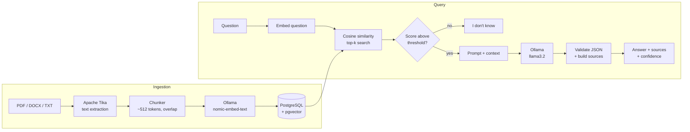

# Enterprise RAG Knowledge Base

A private question-answering backend. Upload company documents (PDF, DOCX, TXT), then ask questions in plain
language. The system finds the most relevant passages and a **local LLM answers using only those passages**,
returning validated JSON with **cited sources**.

Everything runs locally and for free: no cloud API keys, and your documents never leave your machine.

> **About hallucinations:** no RAG system can promise zero hallucination. This project reduces it with
> retrieval thresholds (no relevant text means no LLM call), a strict prompt, schema-validated JSON, and sources that
> are built from the retrieved chunks, so the model cannot invent a citation.

## Architecture



## Tech stack

| Area | Technology |
|---|---|
| Backend | Java 21, Spring Boot 3.3 |
| Database | PostgreSQL 16 + pgvector (HNSW index, cosine distance) |
| Document parsing | Apache Tika |
| Embeddings | Ollama, `nomic-embed-text` (768 dimensions) |
| LLM | Ollama, `llama3.2:3b` (structured JSON output) |
| Validation | Jackson + Bean Validation |
| Tests | JUnit 5, Mockito, MockMvc |
| Deployment | Docker, Docker Compose |

## Quick start (Docker)

**Prerequisites:** Docker Desktop and [Ollama](https://ollama.com).

```bash
# 1. Download the two models (one time)
ollama pull nomic-embed-text
ollama pull llama3.2:3b

# 2. Configure
cp .env .env        # Windows: copy .env .env   (then edit RAG_API_KEY)

# 3. Start the database and the app
docker compose up --build
```

The API is now at `http://localhost:8080`. Send your key in the `X-API-Key` header on every request except `/api/health`.

## Run locally for development

```bash
docker compose up -d db     # only the database (host port 5433)
mvn spring-boot:run         # or run RagApplication from your IDE
```

If `RAG_API_KEY` is not set, authentication is disabled (a warning is logged). Do not deploy like that.

## API

| Method | Endpoint | Purpose |
|---|---|---|
| GET | `/api/health` | Checks the app, the database and pgvector (no key needed) |
| POST | `/api/documents` | Upload a file (`file`, multipart). Chunks and embeds it. `?embed=false` skips embedding |
| GET | `/api/documents` | List documents with their chunk counts |
| DELETE | `/api/documents?source=name.pdf` | Delete a document and its chunks |
| POST | `/api/embeddings/run` | Embed any chunks that still have no vector |
| GET | `/api/embeddings/status` | Embedding progress |
| POST | `/api/search` | Semantic search, returns the top chunks |
| POST | `/api/ask` | Full RAG answer with sources |

A ready-made Postman collection is in [`postman/`](postman/). Import it and set the `apiKey` variable.

### Example

```bash
curl -X POST http://localhost:8080/api/documents \
  -H "X-API-Key: $RAG_API_KEY" \
  -F "file=@company_handbook.pdf"

curl -X POST http://localhost:8080/api/ask \
  -H "X-API-Key: $RAG_API_KEY" \
  -H "Content-Type: application/json" \
  -d '{"question": "What is the data classification policy?"}'
```

```json
{
  "question": "What is the data classification policy?",
  "answer": "Data is classified into four levels: Public, Internal, Confidential and Restricted.",
  "sources": [
    { "source": "company_handbook.pdf", "chunkIndex": 12, "score": 0.8123 }
  ],
  "confidence": 0.9,
  "timestamp": "2026-11-24T10:15:30.123Z"
}
```

Errors always use the same shape:

```json
{ "timestamp": "...", "status": 400, "error": "Bad Request", "message": "question: must not be blank" }
```

## Configuration

| Property | Environment variable | Default | Meaning |
|---|---|---|---|
| `rag.security.api-key` | `RAG_API_KEY` | empty (auth off) | Required `X-API-Key` value |
| `rag.chunking.size-words` | | 380 | Chunk size (about 512 tokens) |
| `rag.chunking.overlap-words` | | 40 | Overlap between chunks |
| `rag.retrieval.top-k` | | 5 | Chunks sent to the LLM |
| `rag.retrieval.min-score` | | 0.4 | Minimum cosine similarity to keep a chunk |
| `rag.embedding.model` | | nomic-embed-text | Must match the `VECTOR(n)` column |
| `rag.llm.model` | | llama3.2:3b | Chat model |
| `rag.llm.num-ctx` | | 8192 | LLM context window |
| `rag.ollama.base-url` | `RAG_OLLAMA_BASE_URL` | http://localhost:11434 | Where Ollama runs |

## Design decisions

- **Interfaces for models:** `EmbeddingService` and `LlmClient` hide Ollama, so OpenAI or Gemini can be added without touching the pipeline.
- **No relevant chunks means no LLM call:** faster, cheaper, and the strongest guard against made-up answers.
- **Sources come from the database, not the model:** the LLM only reports which numbered chunks it used.
- **Re-uploading a file replaces its chunks,** so there are no duplicates.
- **HNSW index** instead of ivfflat: works on an empty table and needs no tuning at this size.

## Limitations and future work

- Chunking counts words as an approximation of tokens (a real tokenizer would be more precise).
- Scanned PDFs without a text layer need OCR, which is not included.
- `confidence` is the model's own estimate and is only a rough signal.
- Single tenant with one shared API key (no per-user access control).
- Ideas: streaming answers, async ingestion for large files, an evaluation set of question/answer pairs, a React frontend, Testcontainers integration tests.

## Tests

```bash
mvn test
```
